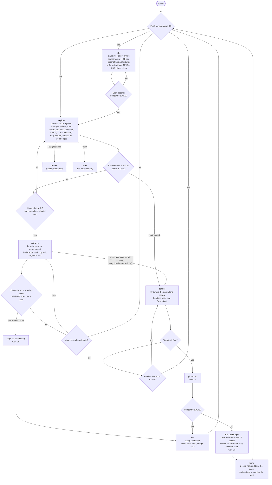

# NPC blue jay state machine

Source: `src/game/npc.ts`. Update this chart whenever the AI changes.

- **Rectangles** are states; **diamonds** are decision points (checks made when entering a state or once per second).
- Probabilistic transitions are rolled **once per second** per NPC; everything else is checked every frame.
- **Noticing:** a standing bird always notices every free acorn in view (so on landing everything in view counts as seen). A flying bird gets one roll (`NPC_NOTICE_PROBABILITY` = 0.75) for each acorn that newly enters its view. A noticed acorn stays noticed while it stays in view (leaving view forgets it, so it rolls again on re-entry). What is in view depends on the direction the bird faces.
- Acorn perception: a third of a typical (16:9) screen width ahead and about one bird-width behind (`NPC_PERCEIVE_AHEAD_IN_SIZES` / `NPC_PERCEIVE_BEHIND_IN_SIZES`, measured in player sizes so it never depends on the window). Hunger thresholds: eat below 2/3 (`HUNGER_THRESHOLD`), idle above 0.9 (`NPC_IDLE_HUNGER`).
- Pauses (`NPC_WAIT_SECONDS` = 1 s, no movement or action): after picking up an acorn, after landing to bury, and when entering explore.
- Walking on the ground is done in hops; picking up, burying and digging play short animations (`PICKUP_DURATION`, `BURY_DURATION`).
- **Override:** a bird holding an acorn while below the eat threshold always switches to **eat**, whatever state it was in, except while finding a burial spot or burying, where it only eats the acorn when starving (below `NPC_STARVING_HUNGER`, 0.2). A bird holding an acorn it cannot eat (hunger above the threshold) in explore or idle goes to find a burial spot instead.
- Each NPC remembers the x position of every acorn it buries (`memory`); a spot is forgotten when it is visited, whether or not an acorn is still there. A dig is tied to a place, not to a remembered acorn: whichever buried acorn is nearest the beak (within `DIG_RESPONSE_IN_SIZES`, 0.5 player sizes) comes up.
- Each NPC has a random `nosiness` (0-1, shown above it with its hunger). It has no effect yet.
- `follow` and `hide` are placeholders: not reachable yet (an NPC in them falls back to explore).

## Acorn supply

Each second every oak has a small chance (`ACORN_DROP_CHANCE_PER_SECOND`) to drop a group of 3-10 acorns from random points in its canopy; they fall under gravity and become ordinary free acorns.
