# NPC blue jay state machine

Source: `src/game/npc.ts`. Update this chart whenever the AI changes. Squirrels share this code and have their own state machine document, `SQUIRREL_STATE_MACHINE.md`.

- **Rectangles** are states; **diamonds** are decision points (checks made when entering a state or once per second).
- Probabilistic transitions are rolled **once per second** per NPC; everything else is checked every frame.
- **Noticing:** a standing bird always notices every free acorn in view (so on landing everything in view counts as seen). A flying bird gets one roll (`NPC_NOTICE_PROBABILITY` = 0.75) for each acorn that newly enters its view. Once noticed, an acorn is **remembered even after it leaves view** and never rolls again; the bird remembers the spot where it last saw it. When that spot comes back into view and the acorn is no longer there, it is forgotten immediately (the bird does not have to land). Until then a taken acorn is still remembered and still draws the bird's explore direction. An acorn that failed its roll can roll again when it re-enters view. What is in view depends on the direction the bird faces.
- Acorn perception: a third of a typical (16:9) screen width ahead and about one bird-width behind (`NPC_PERCEIVE_AHEAD_IN_SIZES` / `NPC_PERCEIVE_BEHIND_IN_SIZES`, measured in player sizes so it never depends on the window). Hunger thresholds: eat below 2/3 (`HUNGER_THRESHOLD`), idle above 0.9 (`NPC_IDLE_HUNGER`).
- Pauses (`NPC_WAIT_SECONDS` = 1 s, no movement or action): after picking up an acorn, after landing to bury, and when entering explore.
- Walking on the ground is done in hops; picking up, burying and digging play short animations (`PICKUP_DURATION`, `BURY_DURATION`).
- **Override:** a bird holding an acorn while below the eat threshold always switches to **eat**, whatever state it was in, except while finding a burial spot or burying, where it only eats the acorn when starving (below `NPC_STARVING_HUNGER`, 1/3, the same threshold that sends it to retrieve). A bird holding an acorn it cannot eat (hunger above the threshold) in explore or idle goes to find a burial spot instead.
- Each NPC remembers the x position of every acorn it buries (`Player.burials`, kept for every bird); a bird knows exactly where each of its acorns went, so a burial leaves its list only when that very acorn is gone: the bird digs up its own acorn (even while digging for another bird's site), a dig of its own comes up empty (no acorn within dig range, so any burial remembered there was taken), or it sees another bird dig up one of its own acorns (the dig in its view: about 4.7 sizes ahead, 1 behind). That dig is not noted as another bird's site either: nothing of anyone else's is left there. Only that one burial is forgotten. **Burying and digging both act exactly at the beak tip** (the bird's centre plus 54 sprite units in its facing direction, scaled by size; `beakTipX`). A dig targets the buried acorn closest to the beak tip within `DIG_RESPONSE_IN_SIZES` (1/4 of a player size, hardcoded; it used to be 1/3 around wherever the bird was told to dig, briefly 0.84); if that acorn is not exactly under the beak the bird shuffles sideways during the first part of the animation so that its beak lands on it. With nothing in range the bird digs where it stands and nothing comes up. NPCs put their beak exactly on the spot they mean to bury or dig at before acting (`moveBeakTo`: fly and land with the centre offset by the beak reach, hop the last stretch, turn with a one-frame tap if needed). The player always gets the nearest one. An NPC digging at another bird's site (gather) never brings up one of its own acorns (`PlayerAction.avoidOwn`): the nearest other acorn in range comes up, or nothing (an empty dig then makes it forget other-bird sites in range, but keeps its own burial memory when an own acorn is there); only in the retrieve state may it dig up its own.
- **Noticing a burial site** (`perceiveBuried`): when another bird's buried acorn (never the bird's own, which it already knows) newly comes into view, the bird may notice it with a probability that falls with the hops that disguised the mound (`burialSiteVisibility` in `vision.ts`, an exponential decay pinned to 0 at the 10th hop: 1, .60, .36, .22, .13, .08, .04, .02, .01, .004, 0 for 0..10 hops; `BURIAL_NOTICE_DECAY_PER_HOP` = 0.5; noticing burying and digging in progress is unaffected) times, while flying, the 0.75 notice scalar; a bird that lands with the site still in view rolls once more without that penalty. A noticed site joins the other-bird burial site list below (never for the exact spot of one of the bird's own remembered burials: the two lists never share a spot, and own burials are only visited when retrieving; a spot merely near an own burial can still be another bird's site) (a site it already remembers is not rolled for).
- **Other birds' burial sites:** when any bird (the player or another NPC) is burying an acorn or digging one up, an NPC can notice it at **any moment from the action's halfway point to its end** (when the head touches the ground while burying, or the acorn enters the beak while digging; an attempted dig that finds nothing is never noticed) (the first moment the spot is in view, e.g. after turning or landing; one roll per observer per action, same view as for free acorns: standing = always, flying = 75%, but a flying bird that missed its roll notices anyway once it lands with the spot in view) and remembers the spot in `sites` and a dashed white line from the NPC to the spot is drawn and fades over `NOTICE_LINE_FADE_SECONDS` (2 s), following the bird as it moves. The site is remembered without needing to be noticed again. While in view it is treated like a free acorn: the NPC gathers it by digging there (a dig is tied to the place, so any buried acorn within `DIG_RESPONSE_IN_SIZES` of the beak comes up) and then eats or buries what it got. A dug-up spot is remembered too, since birds often bury near each other, even though it may now be empty. A site stays remembered after a successful dig and is dropped only when a dig by this NPC within range of it comes up empty.
- **Flying to a ground target** (gather, retrieve, find burial spot, idle trips) follows a straight line: the bird starts at its current altitude (taking off only to a low cruising height of about one bird-size when the target is more than 2 bird widths away; nearer ground targets are hopped to, never flown to) and descends steadily along the direct line, or along the steepest glide it can manage, so it never climbs more than necessary and arrives at ground level.
- Each NPC has random `nosiness` and `secrecy` (0-1, shown above it with its hunger). Nosiness has no effect yet. **Secrecy** sets how many times it hops over a fresh burial site (see `cover`): secrecy x 10 hops rounded up (at least 1, at most 10); it also decides where it buries: a spot must have a burial quality above the bird's secrecy.
- **Burial quality** (`burialQuality` in `burial.ts`, 0-1, for a bird looking to bury at a spot): starts at 1; each other bird (the player too) within half a screen width of the spot, wherever the burying bird is, lowers it by 0.8 if that bird can see the spot (the same view used for finding acorns and noticing digs: about 4.7 sizes ahead, 1 behind) and by 0.4 if it is within half a screen of the spot but cannot see it; an oak lowers it by up to 0.5 (at its trunk centre, linearly to 0 at the farthest an acorn can fall); a place where the burier itself remembers burying an acorn (`Player.burials`) lowers it by 0.2 at the place, easing linearly to 0 two dig tolerances (2/3 of a bird size) away (`BURIAL_QUALITY_OWN_SITE_PENALTY`; the player's heatmap uses the player's own list); within dig range of a remembered burial site of another bird lowers it by 0.9 (`BURIAL_QUALITY_OTHER_SITE_PENALTY`; the owner may come to dig there and would get the new acorn; for the player's heatmap those are the spots where the player dug up an acorn that was not its own, until a later dig there comes up empty: `Player.dugSites`); the creek scores 0; never below 0. There is no smoothing. A bird can judge spots up to half a screen width either side of itself. The quality of the spot it buries at is shown above its head for 4 seconds from when it starts burying.
- **Hiding burial mounds:** any bird (the player too) that starts a hop within 1.1 bird sizes of a buried acorn kicks 3 leaves onto its mound and counts a hop for it; the mound flattens and fades smoothly toward the ground's colour (`Acorn.conceal` eases toward (hops / 10) ^ 2.2, so early hops change the mound little and the last ones the most) and after the tenth hop is no longer drawn at all. Every hop on the ground kicks up leaves and disturbs (shrinks, sinks and fades to the ground colour) older kicked leaves nearby, replacing them with new ones, and the ground starts with kicked-up leaves in piles everywhere, so a pile of kicked leaves never marks a burial. The acorn is still buried there and can still be dug up.
- `follow` and `hide` are placeholders: not reachable yet (an NPC in them falls back to explore).

```mermaid
flowchart TD
    START([spawn]) --> rest

    rest{"Fed? hunger above 0.9"}
    rest -- "yes" --> idle
    rest -- "no" --> explore

    idle["<b>idle</b><br/>stand still (land if flying);<br/>sometimes (p = 0.3 per second) hop a short way<br/>or fly a short hop (35%) of 1.5-5 player sizes"]
    idle --> hungry{"Each second:<br/>hunger below 0.9?"}
    hungry -- "yes" --> explore
    hungry -- "no" --> idle

    explore["<b>explore</b><br/>pick the direction toward the nearest remembered free acorn or<br/>other-bird burial site (toward the nearest foreground oak if none); pause 1 s looking both ways<br/>(away from, then toward, that direction); fly that way, vary altitude,<br/>bounce off world edges; anything newly in view can distract it (see below)"]
    explore --> sees{"Each second: a remembered acorn<br/>or site currently in view?"}
    sees -- "yes (nearest free acorn or<br/>other bird's burial site, whichever is closer)" --> gather
    sees -- "no" --> starving{"Hunger below 1/3<br/>and remembers a burial spot?"}
    starving -- "yes" --> retrieve
    starving -- "no" --> explore

    retrieve["<b>retrieve</b><br/>fly to the nearest remembered<br/>burial spot, land, hop to it,<br/>forget the spot"]
    retrieve -- "a free acorn comes into view<br/>(any time before arriving)" --> gather
    retrieve --> still{"Dig with the beak on the spot: a buried acorn<br/>within 1/4 size of the beak?"}
    still -- "yes (nearest one)" --> dug["dig it up (animation)<br/>wait 1 s"]
    dug --> eat
    still -- "no" --> more{"More remembered spots?"}
    more -- "yes" --> retrieve
    more -- "no" --> rest

    gather["<b>gather</b><br/>fly toward the acorn or burial site, land nearby,<br/>hop to it, peck it up or dig there (animation)"]
    gather --> free{"Target still there?<br/>(acorn still free / site still remembered)"}
    free -- "yes" --> picked["got an acorn<br/>(a dug site stays remembered)<br/>wait 1 s"]
    free -- "dig came up empty" --> forget["forget the site"]
    forget --> another
    free -- "no" --> another{"Another free acorn<br/>in view?"}
    another -- "yes" --> gather
    another -- "no" --> rest

    picked --> hungryEat{"Hunger below 2/3?"}
    hungryEat -- "yes" --> eat
    hungryEat -- "no" --> find

    eat["<b>eat</b><br/>eating animation,<br/>acorn consumed, hunger +1/3"]
    eat --> rest

    find["<b>find burial spot</b><br/>pick a random direction and keep flying that way, judging every spot it can see<br/>(its perception region, nearest first; burial quality) until a spot's quality &gt; secrecy;<br/>land there and judge it again: still &gt; secrecy: wait 1 s and bury;<br/>otherwise take off and keep looking"]
    find -. "each second: another jay flying ahead the same way? 40% to turn around" .-> find
    find --> bury

    bury["<b>bury</b><br/>peck a hole and bury the acorn<br/>(animation); remember the spot"]
    bury --> cover

    cover["<b>cover</b><br/>hop over the fresh burial site back and forth:<br/>as many hops as its secrecy rounded up to the next tenth<br/>(at least 1; each hop fades the mound a bit more, 10 hide it completely)"]
    cover --> rest

    explore -. "TBD (nosiness)" .-> follow
    explore -. "TBD" .-> hide
    follow["<b>follow</b><br/>(not implemented)"]
    hide["<b>hide</b><br/>(not implemented)"]

    style follow stroke-dasharray: 4 4
    style hide stroke-dasharray: 4 4
```

## Acorn supply

Each second every oak has a small chance (`ACORN_DROP_CHANCE_PER_SECOND`, times (birds + squirrels) / birds because the squirrels need acorns too) to drop a group of 2-5 acorns from random points in its canopy; they fall under gravity and become ordinary free acorns.
