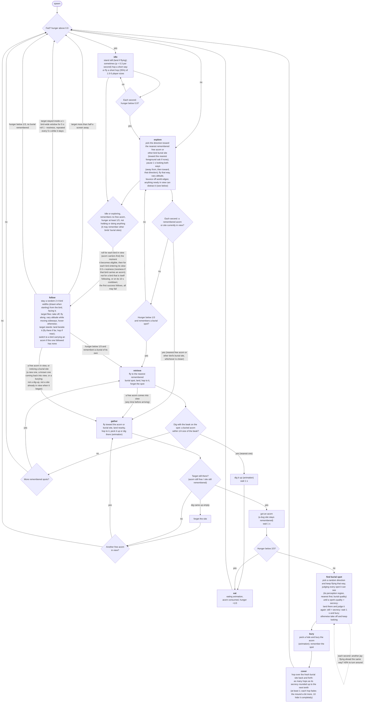

# NPC blue jay state machine

Source: `src/game/npc.ts`. Update this chart whenever the AI changes. Squirrels share this code and have their own state machine document, `SQUIRREL_STATE_MACHINE.md`.

- **Rectangles** are states; **diamonds** are decision points (checks made when entering a state or once per second).
- Probabilistic transitions are mostly rolled **once per second** per animal (the follow rolls are event-based, see `context.md`); everything else is checked every frame.
- **Perception:** a third of a typical screen width ahead and about one bird width behind (`NPC_PERCEIVE_AHEAD_IN_SIZES` / `NPC_PERCEIVE_BEHIND_IN_SIZES`). A standing bird always notices free acorns in view; a flying one rolls `NPC_NOTICE_PROBABILITY` (0.75).
- **Override:** a bird holding an acorn while below the eat threshold switches to **eat** whatever it was doing (except while finding a spot or burying, where only starvation does).
- **Pauses** of `NPC_WAIT_SECONDS` (1 s): after picking up an acorn, after landing to bury, and when entering explore.
- **Nosiness** drives **follow** (jays only); **secrecy** sets the cover hops and the burial-quality bar. No hide state.
- Everything else (burial quality, noticing sites, flight paths, follow details, impossible goals, acorn supply) is in `context.md`, section "NPC blue jay behaviour reference".

