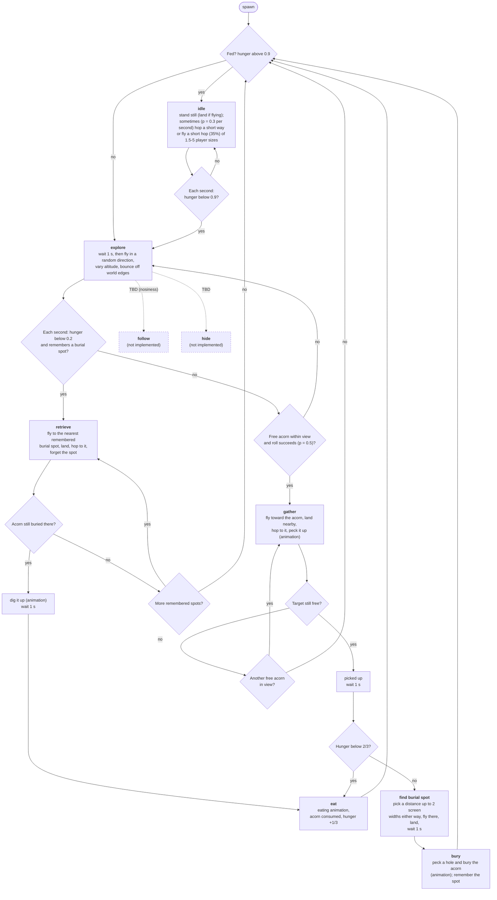

# NPC blue jay state machine

Source: `src/game/npc.ts`. Update this chart whenever the AI changes.

- **Rectangles** are states; **diamonds** are decision points (checks made when entering a state or once per second).
- Probabilistic transitions are rolled **once per second** per NPC; everything else is checked every frame.
- Viewing distance = 1/3 of the screen width (`NPC_VIEW_FRACTION`). Hunger thresholds: eat below 2/3 (`HUNGER_THRESHOLD`), idle above 0.9 (`NPC_IDLE_HUNGER`).
- Pauses (`NPC_WAIT_SECONDS` = 1 s, no movement or action): after picking up an acorn, after landing to bury, and when entering explore.
- Walking on the ground is done in hops; picking up, burying and digging play short animations (`PICKUP_DURATION`, `BURY_DURATION`).
- Each NPC remembers the x position of every acorn it buries (`memory`); a spot is forgotten when it is visited, whether or not an acorn is still there.
- Each NPC has a random `nosiness` (0-1, shown above it with its hunger). It has no effect yet.
- `follow` and `hide` are placeholders: not reachable yet (an NPC in them falls back to explore).

## Acorn supply

Each second every oak has a small chance (`ACORN_DROP_CHANCE_PER_SECOND`) to drop a group of 3-10 acorns from random points in its canopy; they fall under gravity and become ordinary free acorns.
