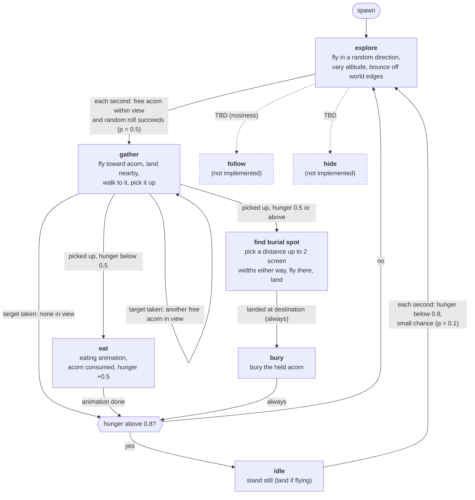

# NPC blue jay state machine

Source: `src/game/npc.ts`. Update this chart whenever the AI changes.

- After gather fails, eat, or bury, an NPC "rests": it goes to **idle** if hunger is above 0.8 (`NPC_IDLE_HUNGER`), otherwise to **explore**.
- There are 5 NPCs (`NPC_COUNT`).
- Probabilistic transitions are evaluated **once per second** per NPC; all others are deterministic and checked every frame.
- Viewing distance = 1/3 of the screen width (`NPC_VIEW_FRACTION`). Hunger threshold = 0.5 (`HUNGER_THRESHOLD`).
- Each NPC has a random `nosiness` (0-1, shown above it with its hunger). It has no effect yet.
- `follow` and `hide` are placeholders: not reachable yet (an NPC in them falls back to explore).

