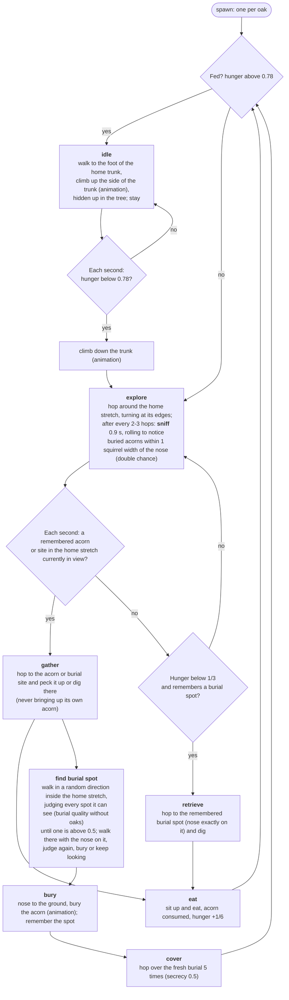

# NPC squirrel state machine

Source: `src/game/squirrel.ts` (tree, sniffing, home stretch) plus the shared animal code in `src/game/npc.ts` (a squirrel is an `Npc` with `home` set; blue jays have `home = null`). Update this chart whenever the squirrel AI changes. It starts as a copy of the blue jay machine (`NPC_STATE_MACHINE.md`) and diverges where listed below; anything not listed behaves as described there (perception, noticing burial sites and digs, burial quality, hiding mounds, remembered burials, digging at the beak tip, ...).

- **Rectangles** are states; **diamonds** are decision points (checks made when entering a state or once per second).
- Probabilistic transitions are rolled **once per second** per animal; everything else is checked every frame.

## How a squirrel differs from a blue jay

- **One per oak.** Every oak tree has one squirrel (`createSquirrels`, `world.squirrels`). It is a little smaller than the jay (`SQUIRREL_SIZE_FRACTION` = 0.8 of the player's size), gray with a bushy tail.
- **Never flies.** All movement is hopping on the ground (`npc.keys.w` is forced off), at `SQUIRREL_SPEED_SCALE` (1.0 of the player's walking speed; jays use 0.75). Anything a jay would fly to (a far acorn, a burial spot) a squirrel hops to.
- **Stays in its home stretch.** `home = { tree, trunkX, left, right }`: the ground within the reach of its oak's crown (`acornReach`, where the oak's acorns can land) on either side of the trunk. It turns round at the edges, and only free acorns, burial sites and burial spots inside the stretch are considered (`inHome`). Its remembered own burials are always inside it.
- **Idle = up the tree.** In **idle** a squirrel walks to the foot of its home trunk, climbs up (animation along the side of the trunk, `SQUIRREL_CLIMB_SPEED_IN_SIZES` = 2.4 sizes per second) and is **hidden** (`bird.hidden`) once `SQUIRREL_HIDE_HEIGHT_IN_SIZES` (5.5 sizes) up: not drawn, perceives nothing, not perceived by anyone, not counted for burial quality. It stays up there until it leaves idle (hunger low enough), then climbs down the trunk (animation) and starts exploring. Squirrels that start fed (`hunger > SQUIRREL_IDLE_HUNGER`) begin hidden in their tree.
- **Hunger.** The bar is twice as large (`SQUIRREL_HUNGER_SCALE` = 2): it drains in 120 s instead of 60 s and an acorn fills 1/6 of it instead of 1/3 (`Player.hungerScale`). The thresholds are still fractions of the bar (eat below 2/3, retrieve below 1/3), except idle: `SQUIRREL_IDLE_HUNGER` = 0.78 instead of 0.9 (an acorn only fills a sixth, so after eating a squirrel sits near 0.83; 0.9 would almost never be reached). Each squirrel needs the same number of acorns per second as a jay, so the acorn drop chance and the world cap are multiplied by (birds + squirrels) / birds in `updateTreeDrops`.
- **Secrecy is always 0.5** (`SQUIRREL_SECRECY`): it hops over a fresh burial 5 times, and only buries at spots with burial quality above 0.5. **Oaks are ignored in its burial quality** (`burialQuality(..., useOaks = false)`).
- **Sniffing.** While exploring, after every 2 or 3 hops (`SQUIRREL_SNIFF_EVERY_HOPS_MIN/MAX`) the squirrel stops and sniffs for `SQUIRREL_SNIFF_SECONDS` (0.9 s), nose to the ground. When a sniff starts, every buried acorn of another animal within one squirrel width of its nose (`SQUIRREL_SNIFF_RADIUS_IN_SIZES` = 1, measured from the nose tip) gets one roll to be noticed, with the usual chance (it falls with the hops that disguised the mound) **doubled** (`SQUIRREL_SNIFF_NOTICE_FACTOR` = 2, capped at 1): 100% for a fresh mound, 44% at 3 hops, 9% at 6, 1% at 9. A noticed mound joins the squirrel's list of other animals' burial sites like any noticed site, and the dashed notice line is drawn from its eye.
- **Its nose is the beak.** Burying and digging act at the nose tip: 44 sprite units ahead of its centre (`SQUIRREL_NOSE_REACH_X`, scaled by size). The dig range (1/4 of a bird size) and everything derived from it scale with the squirrel's own size.
- **Interacting with jays.** Squirrels and jays (and the player) are all "birds" as far as perception goes: a visible squirrel counts for a jay's burial quality, jays and squirrels notice each other's burials and digs, they compete for free acorns, and everyone's hops kick leaves onto mounds. Only the squirrel's hidden/climbing state changes that: a hidden squirrel is ignored.

## States

Same states as the jay: idle, explore, gather, eat, retrieve, find burial spot, bury, cover (follow and hide are placeholders). Differences:

## Acorn supply

The acorn drop chance per oak (and the cap on acorns in the world) is multiplied by (birds + squirrels) / birds, because each squirrel needs as many acorns per second as a jay (twice the bar, drained half as fast, an acorn filling half as much of it). With 3 jays, the player and 3 squirrels that is 7/4.
