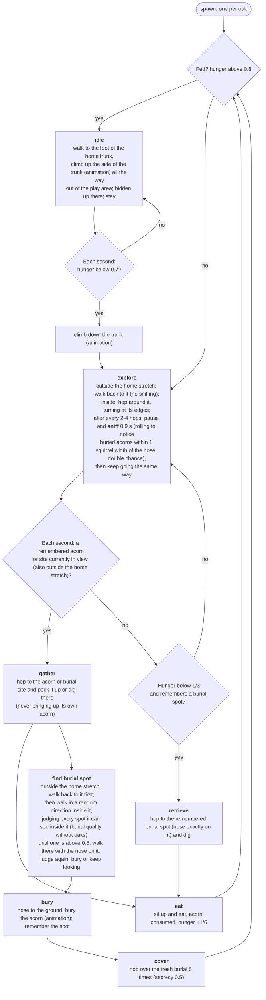

# NPC squirrel state machine

Source: `src/game/squirrel.ts` (tree, sniffing, home stretch) plus the shared animal code in `src/game/npc.ts` (a squirrel is an `Npc` with `home` set; blue jays have `home = null`). Update this chart whenever the squirrel AI changes. It starts as a copy of the blue jay machine (`NPC_STATE_MACHINE.md`) and diverges where listed below; anything not listed behaves as described there (perception, noticing burial sites and digs, burial quality, hiding mounds, remembered burials, digging at the beak tip, ...).

- **Rectangles** are states; **diamonds** are decision points (checks made when entering a state or once per second).
- Probabilistic transitions are mostly rolled **once per second** per animal (the follow rolls are event-based, see `context.md`); everything else is checked every frame.
- **Differences from a blue jay:** one per oak, never flies (hops), fuzzy home stretch around its oak, idle = up the tree (hunger 0.8 / 0.7), double-size hunger bar, secrecy 0.5 with no oak term in burial quality, 0.1-0.4 s pause between hops while wandering, sniffing every 2-4 hops, no nosiness / follow / hide. Details in `context.md`, section "NPC squirrel behaviour reference".

